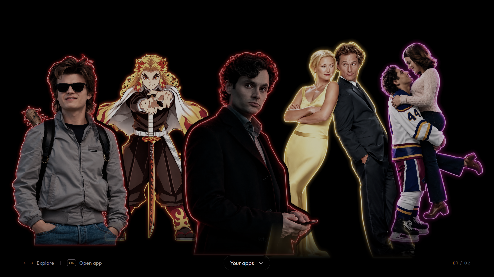
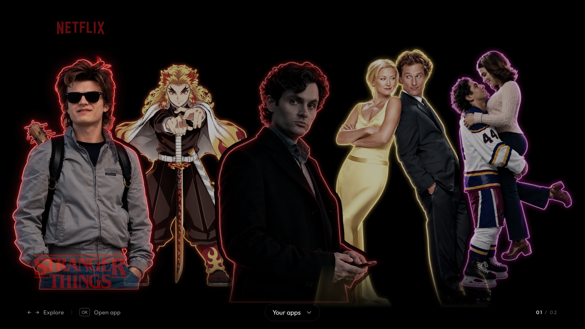
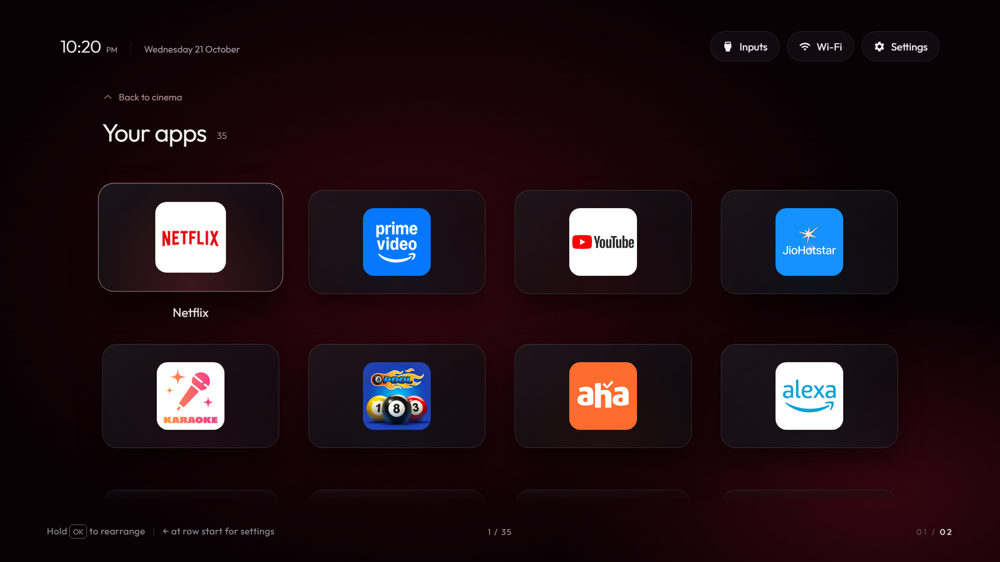
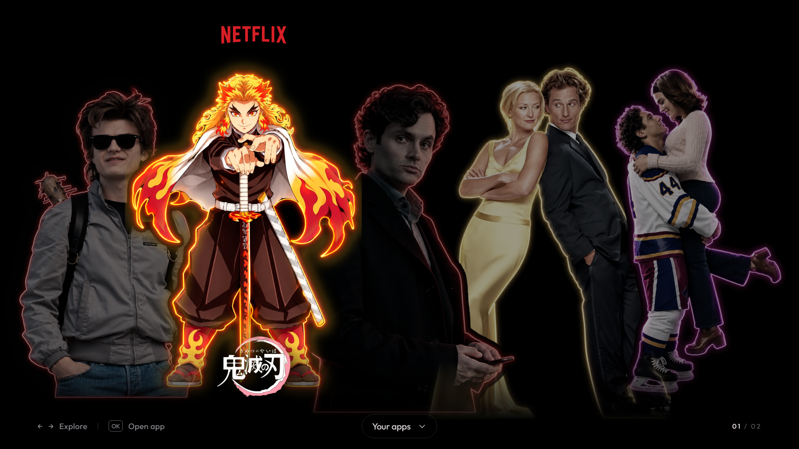
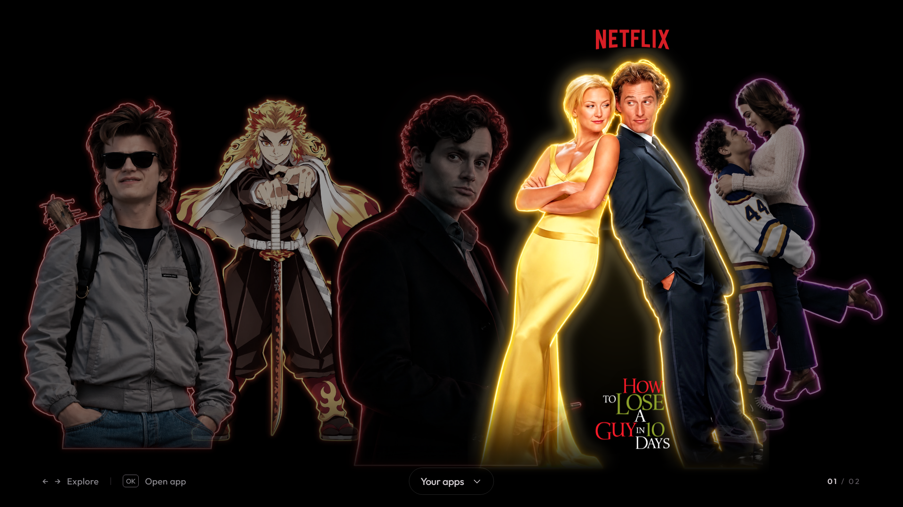
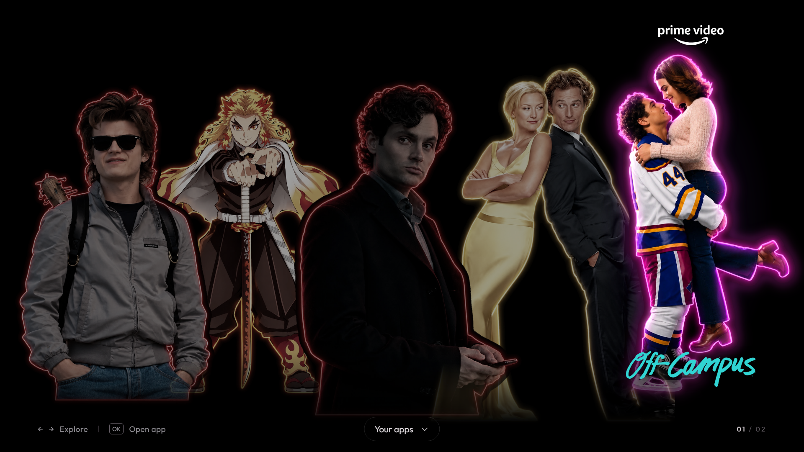
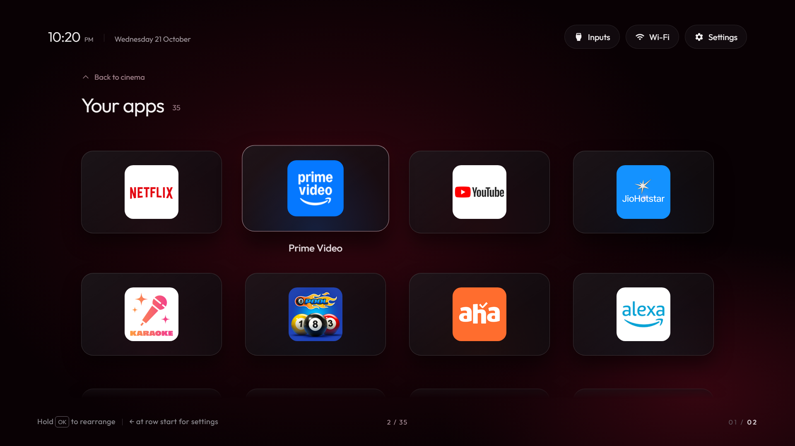

# 🎬 Cinema comes home

<div align="center">

### A cinematic launcher for your LG webOS TV

**Five favourite characters. A black canvas. Your apps, one move away.**

[](app/appinfo.json)
[](#compatibility)
[](LICENSE)
[](#choose-your-route)

[See the demo](#demo) · [Install on your TV](#manual-setup) · [Use Codex](#codex-setup) · [Use Claude Code](#claude-setup) · [Get help](#troubleshooting)

</div>



**webos_vibehack_Qned** turns a regular app launcher into a character-led home screen. Move across the artwork to reveal title logos and individual glows, then move down into a crimson dashboard populated from **your TV's installed apps**.

The interface is already built. You do not need to ask an AI to recreate it: clone this repository, pair your TV, synchronize its apps, and install the launcher.

> [!NOTE]
> This is a webOS **launcher app**, not replacement firmware or a new operating system. LG's original home screen remains available. No rooting is needed. The optional Home-button watcher runs on a separate computer.

<a id="demo"></a>
## ✨ See what you are installing

| Character focus | Your application dashboard |
| --- | --- |
|  |  |
| Artwork lifts, glows, and reveals its title. | Real apps with remote and pointer navigation. |

<details>
<summary>🖼️ More screenshots — expand the gallery</summary>

| Rengoku | Joe |
| --- | --- |
|  |  |

| Benjamin | Hannah |
| --- | --- |
|  |  |



</details>

These are 1920 × 1080 **desktop captures of this project's UI**, not photographs of the television. Version 1.2.0 was installed and launched on the maintainer's LG TV. Your app icons, app count, input names, and available streaming services depend on your TV and region. Screenshots were captured before the latest app inventory refresh.

**Included:** character/title artwork, directional navigation, pointer handling, wheel transitions, app rearrangement, input shortcuts, reduced-motion support, and local assets. Selecting a character opens its configured streaming app; it does **not** automatically play the pictured show or provide a subscription.

<a id="choose-your-route"></a>
## 🧭 Choose your setup route

| Route | Best for | Start here |
| --- | --- | --- |
| **Manual commands** | You want to run and understand each step yourself. | [Manual setup](#manual-setup) |
| **Codex** | You want a local coding assistant to guide execution. | [Codex setup](#codex-setup), then the [stage prompts](#stage-prompts) |
| **Claude Code** | You prefer Claude Code in your local terminal/editor. | [Claude Code setup](#claude-setup), then the [stage prompts](#stage-prompts) |

All routes install the same app. AI tools are optional and may require their own account or paid access. The TV launcher itself does not use an AI API.

**Your journey:** prepare computer → enable Developer Mode → pair installation access → pair app synchronization → preview → install → check on TV.

<a id="compatibility"></a>
## 📺 Compatibility and expectations

| Item | What to know |
| --- | --- |
| TV | LG **webOS**, with the Developer Mode app available. Older NetCast TVs are outside this guide. |
| Recorded deployment | LG **65QNED83SRA**, targeting the webOS 25 engine; version 1.2.0 installation and launch confirmed. |
| Other models | Not universally validated. Record your exact model, webOS version, and firmware before starting. |
| Computer | Windows PowerShell is the primary documented path. macOS uses the shell installer. Linux uses the manual packaging path below. |
| Network | Computer and TV on the same local network. Guest Wi-Fi, VPN routing, or device isolation can prevent connection. |
| Rendering | A 1920 × 1080 logical canvas scales to the screen. Performance and remote behavior need checking on your TV. |
| Validation | [Browser checks](docs/redesign/validation.json) passed with a simulated webOS bridge. They do not prove every physical-TV interaction. |

Use LG's [Developer Mode guide](https://webostv.developer.lge.com/develop/getting-started/developer-mode-app) and [web engine table](https://webostv.developer.lge.com/develop/specifications/web-api-and-web-engine) when checking your model.

## 🧰 Before you start

Prepare your TV model/webOS/firmware versions, its local IP, a remote, an LG developer account, and a computer with [Git](https://git-scm.com/downloads), [Node.js/npm](https://nodejs.org/en/download), and [Python 3](https://www.python.org/downloads/). Keep the television visible during pairing.

The recorded Windows deployment used Node **24.14.0**, Python **3.13.7**, websockets **16.1**, and Pillow **12.1.1**. These are observed working versions, not a universal minimum or a reason to downgrade. See LG's [CLI installation guidance](https://webostv.developer.lge.com/develop/tools/cli-installation) for its published requirements.

> [!IMPORTANT]
> Replace example IP `192.168.1.50` with **your TV's IP**. Keep LG passwords, Developer Mode passphrases, SSH keys, `.lgtv-key.json`, and AI tokens private. Enter secrets locally when prompted, not in GitHub issues or AI chats. Device-list output and TV screenshots can contain passphrases—redact them before sharing.

<a id="manual-setup"></a>
## 🛠️ Route A — manual setup

Run commands from the repository root unless stated otherwise. PowerShell and Bash blocks are alternatives. Stop at a failed checkpoint and use [troubleshooting](#troubleshooting) before continuing.

### 1. Download the project and prepare your computer

In PowerShell on Windows or Terminal on macOS/Linux:

```sh
git clone https://github.com/abhinavpanchagni/webos_vibehack_Qned.git
cd webos_vibehack_Qned
git --version
node --version
npm --version
```

**Windows PowerShell:**

```powershell
py -3 --version
py -3 -m venv venv
.\venv\Scripts\python.exe -m pip install websockets Pillow
```

If `py` is missing but `python --version` reports Python 3, use `python` instead of `py -3`. No virtual-environment activation is necessary; the commands use its Python directly.

**macOS / Linux:**

```bash
python3 --version
python3 -m venv venv
./venv/bin/python -m pip install websockets Pillow
```

Install LG's CLI once, on either platform:

```sh
npm install -g @webos-tools/cli
ares -V
```

If global installation is unavailable, prefix each `ares-*` command with `npx -y -p @webos-tools/cli`, for example `npx -y -p @webos-tools/cli ares-setup-device`. The installers provide this fallback automatically.

**✅ Checkpoint:** version commands work, Python dependencies installed, and the folder contains `app/`, `install.ps1`, `install.sh`, and `sync-apps.py`.

### 2. Prepare the LG TV

1. Create/sign in to an account at the [LG developer site](https://webostv.developer.lge.com/).
2. On the television, install **Developer Mode** from LG Apps/Content Store.
3. Open it and sign in on the TV.
4. Enable **Dev Mode Status** and allow the TV to restart.
5. Reopen Developer Mode and enable **Key Server**.
6. Note its IP address. Keep the displayed passphrase available for the local terminal prompt.

**✅ Checkpoint:** Developer Mode is on, its session has remaining time, and Key Server is enabled. See LG's [official instructions](https://webostv.developer.lge.com/develop/getting-started/developer-mode-app) if your screen differs.

### 3. Pair installation access

This connection installs the `.ipk` package. It is separate from the permission used to read apps in step 4.

Use the interactive CLI setup to avoid shell quoting problems:

```sh
ares-setup-device
```

Choose **add**, then enter:

| Prompt | Value |
| --- | --- |
| Device name | `lgtv` |
| Device IP | Your TV's IP, e.g. `192.168.1.50` |
| Port | `9922` |
| SSH user | `prisoner` |
| Password, if requested | Leave empty for the Developer Mode connection. |
| Description | Any label, e.g. `Living room LG` |
| Save | Yes |

If `lgtv` already exists, choose **modify** and verify its IP. This guide always targets `lgtv` explicitly rather than relying on a default device.

Fetch the key and type the passphrase **at the terminal prompt**:

```sh
ares-novacom --device lgtv --getkey
ares-device --system-info --device lgtv
```

**✅ Checkpoint:** system information belongs to your TV. Fix pairing before installing anything. Device-profile options are covered in [LG's CLI guide](https://webostv.developer.lge.com/develop/tools/cli-dev-guide).

### 4. Synchronize your TV's apps and inputs

Set the IP in your current terminal; set it again when opening a new terminal.

**Windows PowerShell:**

```powershell
$env:TV_HOST = "192.168.1.50"
.\venv\Scripts\python.exe sync-apps.py $env:TV_HOST
```

**macOS / Linux:**

```bash
export TV_HOST="192.168.1.50"
./venv/bin/python sync-apps.py "$TV_HOST"
```

Watch the television and accept the first-run remote-control permission prompt. This is the **second pairing**, used to read apps and inputs. Its local key is saved in `.lgtv-key.json`, which Git ignores.

The script generates `app/apps.js` and downloads icons into `app/icons/`. A fresh clone intentionally excludes these because every TV has a different inventory.

**✅ Checkpoint:** the terminal reports `Synced ... apps and ... inputs`, and the generated files exist. Counts need not match the demo. Read `no icon for ...` warnings: the current script omits an app if its icon download fails. It does not uninstall that app from your TV.

To inspect real app IDs:

```powershell
# Windows
.\venv\Scripts\python.exe sync-apps.py $env:TV_HOST --list
```

```bash
# macOS / Linux
./venv/bin/python sync-apps.py "$TV_HOST" --list
```

### 5. Preview and validate

Serve the app locally:

```powershell
# Windows
.\venv\Scripts\python.exe -m http.server 8000 --bind 127.0.0.1 --directory app
```

```bash
# macOS / Linux
./venv/bin/python -m http.server 8000 --bind 127.0.0.1 --directory app
```

Open **http://127.0.0.1:8000**. Try Left/Right, Down, Up, the pointer, and the wheel. Stop the server with `Ctrl+C`. Desktop browsers cannot launch TV apps, so launch-failure feedback in this preview is expected.

Windows also provides a local installer preflight:

```powershell
powershell -NoProfile -ExecutionPolicy Bypass -File .\install.ps1 -DryRun
```

This checks prerequisites without contacting the TV. The execution-policy option applies to this PowerShell process, not a permanent machine-wide change.

**✅ Checkpoint:** all five characters appear, focus works, and Down opens your app grid. Optional [automated checks](#local-validation) are described below.

### 6. Install and launch

> [!IMPORTANT]
> Both installers delete and recreate the **entire `build/` directory**. Preserve older packages and backups outside that folder first. This also clears optional test dependencies in `build/qa`. Use the manual route below if you want to retain its contents.

**Windows PowerShell:**

```powershell
powershell -NoProfile -ExecutionPolicy Bypass -File .\install.ps1 -TvHost $env:TV_HOST -Device lgtv
```

**macOS:**

```bash
bash ./install.sh
```

The installers sync again, create icons, package the app, install it, and launch it. Windows also closes a running launcher before updating it. The macOS script uses Apple's `sips` tool; **Linux users should follow the manual packaging route**.

**✅ Checkpoint:** installation and launch report success, and the cinematic UI appears on the TV. If the installer stops, read the first error rather than assuming later steps completed.

<a id="manual-package"></a>
<details>
<summary>📦 Manual packaging — Linux, preserving build backups, or debugging individual steps</summary>

Complete steps 1–5 first. Create both launcher icons using Pillow:

```powershell
# Windows
.\venv\Scripts\python.exe -c "from PIL import Image; im=Image.open('assets/icon.jpg').convert('RGBA'); im.resize((80,80),Image.Resampling.LANCZOS).save('app/icon.png'); im.resize((130,130),Image.Resampling.LANCZOS).save('app/largeIcon.png')"
```

```bash
# macOS / Linux
./venv/bin/python -c "from PIL import Image; im=Image.open('assets/icon.jpg').convert('RGBA'); im.resize((80,80),Image.Resampling.LANCZOS).save('app/icon.png'); im.resize((130,130),Image.Resampling.LANCZOS).save('app/largeIcon.png')"
```

Choose an empty output folder for this build. These examples match version 1.2.0 in `app/appinfo.json`:

```sh
ares-package app -o build/releases/1.2.0
ares-launch -d lgtv -r
```

If `com.gathin.tvhome` is running, close it:

```sh
ares-launch -d lgtv -c com.gathin.tvhome
```

Install the **exact filename reported by the packager** and launch:

```sh
ares-install -d lgtv build/releases/1.2.0/com.gathin.tvhome_1.2.0_all.ipk
ares-launch -d lgtv com.gathin.tvhome
```

Change the directory/filename for other versions. This updates the same app ID rather than creating a second launcher. Refresh the inventory using step 4 before manual updates.

</details>

### 7. Verify on the television

```sh
ares-install -d lgtv -F
ares-launch -d lgtv -r
```

Find `com.gathin.tvhome`; confirm its installed `version` matches `app/appinfo.json`.

- [ ] The showcase contains all five characters.
- [ ] Left/Right or the pointer focuses one character at a time.
- [ ] OK opens the configured streaming app, if installed.
- [ ] Down opens the dashboard; all expected visible apps are reachable.
- [ ] Dashboard tiles open the correct app; returning restores usable focus.
- [ ] Inputs, Settings, Back, wheel, and rearrangement work with your remote.
- [ ] Artwork and text fit without unwanted cropping.

If your streaming app has a different regional ID, use IDs from step 4 to configure it. Do not invent content deep links.

🎉 **You now have the same launcher design, populated with your own TV's apps.**

<a id="codex-setup"></a>
## 🤖 Route B — set up with Codex

Use Codex **locally on a computer connected to your TV's network**. A hosted/cloud coding environment normally cannot reach your private TV IP. The assistant can run project commands with your permission; you still operate the TV and enter authentication locally.

1. Clone the repository using manual step 1.
2. With Node/npm installed, install the CLI using the npm method documented by [OpenAI](https://developers.openai.com/cookbook/examples/codex/using_goals_in_codex):

   ```sh
   npm install -g @openai/codex@latest
   ```

   Alternatively, use the platform installer in the [official CLI guide](https://learn.chatgpt.com/docs/codex/cli), or open the cloned folder in your local Codex app/IDE integration.
3. For the CLI, open a terminal in the repository and run:

   ```sh
   codex --version
   codex
   ```

4. Complete the sign-in flow. Keep the normal permissions workflow for file access, package installs, and local-network commands.
5. Paste this opening prompt, followed by the context card below:

```text
You are helping me install this existing LG webOS launcher with Codex.
Use the local repository open in this session as the source of truth.
Read README.md, install.ps1, install.sh, sync-apps.py, lgtv.py,
app/appinfo.json, app/config.js, and app/characters.js.

I want the existing cinematic UI shown in docs/redesign/, not a new design.
Follow the README's staged setup. Begin with a read-only prerequisite check.
Match commands to my OS and shell. Explain the next TV-side action and the
exact evidence needed before proceeding to the next stage.
Have me enter credentials locally at authentication prompts; never display them.
Preserve existing work and backups. Do not deploy until I send the deployment
stage prompt. Publishing, firmware changes, rooting, and Home redirection
are outside the basic setup.
```

Then send the [stage prompts](#stage-prompts) one at a time. No special plugin or AI API key inside the TV app is required. Codex installation and sign-in guidance follows [official OpenAI documentation](https://learn.chatgpt.com/docs/codex/cli).

<a id="claude-setup"></a>
## 🧠 Route C — set up with Claude Code

Use a local Claude Code session with access to this repository and your TV's network.

1. Clone the repository using manual step 1.
2. Install Claude Code using an official method below, or follow its [quickstart](https://code.claude.com/docs/en/quickstart) for alternatives.

   **Windows PowerShell with WinGet:**

   ```powershell
   winget install Anthropic.ClaudeCode
   ```

   **macOS with Homebrew:**

   ```bash
   brew install --cask claude-code
   ```

   **Linux:** follow the current installer/package-manager instructions in the [official quickstart](https://code.claude.com/docs/en/quickstart).

3. Open a new terminal in the repository:

   ```sh
   claude --version
   claude
   ```

4. Follow the first-run login flow with an account supported by Claude Code. Keep normal permission prompts enabled.
5. Paste this opening prompt, then the context card:

```text
You are helping me install this existing LG webOS launcher with Claude Code.
Inspect the local repository before proposing commands. Read README.md,
install.ps1, install.sh, sync-apps.py, lgtv.py, app/appinfo.json,
app/config.js, and app/characters.js.

Reproduce the included UI on my TV by configuring and installing this project.
Do not regenerate the UI or replace its launch logic. Follow the README stages,
starting with prerequisites. Match every command to my OS and shell; if your
terminal uses Bash while I use PowerShell, explain the distinction.
For each stage, report the command result and tell me what to check on the TV.
Have me enter secrets locally, preserve work and backups, and wait for my
explicit deployment-stage prompt before installation. Publishing, firmware
changes, rooting, and Home redirection are outside the basic setup.
```

Continue with the same [stage prompts](#stage-prompts). Claude Code installation, authentication, and account options are covered by its [official quickstart](https://code.claude.com/docs/en/quickstart). This project does not require a particular AI model.

<a id="stage-prompts"></a>
## 💬 Copy-and-paste AI setup playbook

Use these prompts with **either Codex or Claude Code** after the corresponding opening prompt. Send one stage at a time. You do not need to install both assistants.

### First: provide a context card

Replace the brackets. Write `unknown` if you need help finding a value.

```text
Computer OS and version: [Windows 11 / macOS ... / Ubuntu ...]
Terminal/shell: [PowerShell / zsh / bash]
Local repository path: [path to webos_vibehack_Qned]
TV model: [exact model]
webOS version: [version or unknown]
Firmware version: [version or unknown]
TV local IP: [your TV's IP, for this local setup only]
Computer and TV on same network: [yes/no/unknown]
Developer Mode installed and enabled: [yes/no]
Key Server enabled: [yes/no]
Existing LG CLI device profile: [none / lgtv / another name]
Existing launcher installation: [none / version / unknown]
Git, Node/npm, Python installed: [versions or unknown]
Goal: Install this repository's cinematic UI with my TV's own apps.
Current stage or error: [not started, or command + redacted output]
```

**Share:** the exact command, error text, tool versions, sanitized output, and a photo of the UI for visual problems. Give a local agent file paths rather than pasting the whole repository. Redact passphrases, passwords, keys, tokens, and unrelated personal details from screenshots.

**Using ordinary ChatGPT/Claude web chat?** Provide the repository URL, context card, and relevant file contents if it cannot access the repository. Ask for commands you will run locally. A chat response alone does not install anything on the TV.

| Stage | Send when | Evidence before advancing |
| --- | --- | --- |
| 1 — Preflight | Repository is open locally. | Tool/dependency checks and OS-specific plan. |
| 2 — Pair | Developer Mode and Key Server are ready. | TV system-info command succeeds. |
| 3 — Sync | Installation connection works. | Inventory exists; icon warnings reviewed. |
| 4 — Preview | Inventory generated. | Correct UI and reviewed package/target. |
| 5 — Deploy | You are ready to install. | Installation, launch, and version confirmed. |
| 6 — TV checks | New UI is on the TV. | Real remote/app-switching checklist complete. |

### Stage 1 — inspect and prepare

```text
Stage 1: Run a read-only preflight on my computer.
Check Git status, OS/shell, Node/npm, Python 3, the virtual environment,
websockets/Pillow, and LG CLI availability. Identify missing prerequisites
and the smallest OS-appropriate setup steps. Once I approve any required
package installation, prepare the environment. On Windows run install.ps1
-DryRun. Do not contact or modify the TV yet. Report passes and remaining work.
```

**You check:** tool versions work, dependencies installed, and Windows preflight passes. No app has been deployed.

### Stage 2 — connect to the right television

```text
Stage 2: My TV is on, Developer Mode is enabled, and Key Server is enabled.
Use the TV IP in my context card. Inspect CLI configuration without displaying
stored secrets. Reuse or create lgtv with that IP, port 9922, user prisoner.
If authentication is needed, give me the local interactive command and let me
enter the passphrase myself. Verify with ares-device --system-info --device lgtv.
Confirm this is my TV, not an emulator. Do not install the launcher yet.
```

**You check:** reported system information belongs to your television. If the agent cannot interact with the passphrase prompt, run that command in your own terminal and return only its sanitized result.

### Stage 3 — populate your dashboard

```text
Stage 3: Run sync-apps.py for my TV using the project's virtual-environment
Python. Tell me when to accept the remote-control permission prompt on the TV.
Verify app/apps.js and icon files, report app/input counts, and list omissions
or download warnings. Compare app/characters.js streaming IDs with the real
inventory. Explain mismatches before changing mappings. Keep .lgtv-key.json
local and never display its contents.
```

**You check:** the permission was accepted, expected apps appear, and warnings have not been silently described as a complete inventory.

### Stage 4 — preview and prepare a reviewable package

```text
Stage 4: Preview the UI locally and check character assets, focus, transitions,
app-grid navigation, and mappings. Run relevant syntax checks. If supported
local Chrome is available, run scripts/verify-ui.cjs using its documented setup
and CHROME_PATH override. Distinguish simulated launch checks from real TV launches.
Inspect installer build-directory cleanup. Preserve existing backups/packages
outside build, or use manual packaging to retain them.
Prepare the exact app ID, version, target, and package path for my review.
Do not install yet. Report failures honestly instead of bypassing checks.
```

**You check:** the design matches the demo, your grid is populated, and the target/package are correct. If browser automation is unavailable, the agent should say so and give manual checks.

### Stage 5 — authorize installation of this package

```text
Stage 5: I authorize installing and launching the reviewed launcher package on
my paired LG TV. Use the verified lgtv profile and version in app/appinfo.json.
Preserve the previous package if available. Close only this launcher if running,
install the reviewed package, and launch it. Verify the installed app ID/version
with LG's CLI and report actual results. Stop if the target differs from my TV.
Do not change firmware, root the TV, uninstall unrelated apps, publish code,
or enable the optional Home watcher.
```

**You check:** the new UI is physically visible. The assistant should confirm the installed version and command results, not just say “done.”

### Stage 6 — test with your remote

```text
Stage 6: Guide me through real-TV checks: character focus, streaming-app launch,
dashboard navigation, app return, Inputs, Settings, Back, wheel, rearrangement,
and screen fit. Ask for observed results where you cannot inspect the TV.
Record my model, webOS/firmware and failures. Do not claim hardware checks passed
just because desktop tests passed. Suggest Quick Access once navigation works;
explain Home redirection as a separate optional setup.
```

### If something fails — use this debugging prompt

```text
Setup stopped at stage: [number]
Command: [exact command, secrets removed]
Output: [relevant error, secrets removed]
Expected: [what should happen]
Observed on TV: [what actually happened]
Changed since last success: [IP/session/network/package/none]

Diagnose using this evidence and the repository. Start with the smallest
read-only check, explain the cause, and propose a targeted fix. Preserve working
configuration. Do not reset pairing, delete backups, or reinstall unrelated
software speculatively. Tell me what additional evidence is actually needed.
```

<a id="controls"></a>
## 🎮 Everyday controls

| Where | Action | Result |
| --- | --- | --- |
| Showcase | Left / Right, or pointer movement | Focus a character. |
| Showcase | OK / Enter / click | Open its streaming app. |
| Showcase | Down / wheel down / **Your apps** | Open dashboard. |
| Dashboard | Direction keys | Navigate all app rows. |
| Dashboard first row | Up | Return to showcase. |
| Dashboard | Back / wheel up / **Back to cinema** | Return to showcase. |
| App tile | Hold OK, move with arrows, then OK | Save a new position; Back cancels. |
| Start of an app row | Left | Reach Inputs / Wi-Fi / Settings. |
| Inputs menu | Up / Down / OK | Select an input; Back closes the menu. |
| Desktop preview | Tab / Shift+Tab | Traverse visible controls. |

<a id="home-shortcuts"></a>
## 🏠 Make it easy to open

### Option 1 — remote Quick Access

On supported LG remotes, open the launcher and hold an available number key to assign it as a Quick Access app. Hold that key later to reopen it. Check your TV's Quick Access menu if your remote behaves differently. This avoids keeping a computer running.

### Option 2 — optional Home-button watcher

Home normally opens LG's home. [`home-watch.py`](home-watch.py) runs on a **separate computer that stays awake on the same network** and launches this app when LG Home appears. LG Home can flash briefly. The watcher includes a second-Home-press escape within three seconds; verify it on your firmware.

After pairing and installation, try it in the foreground:

```powershell
# Windows; keep the terminal open
.\venv\Scripts\python.exe home-watch.py $env:TV_HOST
```

```bash
# macOS / Linux; keep the terminal open
./venv/bin/python home-watch.py "$TV_HOST"
```

Stop with `Ctrl+C`. Normal LG Home behavior remains when the watcher is stopped, its computer sleeps, or connectivity is lost. The launcher itself does not require an awake computer after installation.

macOS includes a background-service helper:

```bash
TV_HOST="192.168.1.50" bash ./home-watch-mac.sh
```

Remove that service with:

```bash
bash ./home-watch-mac.sh uninstall
```

There is no bundled Windows Task Scheduler or Linux systemd installer. Verify the foreground watcher before creating your own background service.

**Optional assistant prompt:**

```text
The launcher is installed and basic TV checks pass. Explain Quick Access and
home-watch.py for my OS. I want to test the watcher in the foreground first.
Show prerequisites and stop/escape behavior. Do not install a persistent
startup service until I explicitly choose that option.
```

<a id="customize"></a>
## 🎨 Make it yours

| Change | File / setting |
| --- | --- |
| App order defaults, hidden apps, columns, Live TV | [`app/config.js`](app/config.js) |
| Characters, title/app mapping, artwork paths, glow colors, positions | [`app/characters.js`](app/characters.js) |
| Transparent character artwork | `app/assets/characters/` |
| Title/platform logos | `app/assets/titles/`, `app/assets/platforms/` |
| Animation, fonts, spacing, dashboard colors | [`app/style.css`](app/style.css) |
| Package ID and version | [`app/appinfo.json`](app/appinfo.json) |

The legacy `dockApps` setting supplies preferred ordering; changing it can reset the saved arrangement. Keep the application ID when updating the same installation. Keep `deepLink: null` unless you have verified a real content link on your TV.

Use artwork you have permission to use, preserve proportions, and test pointer hit regions after changing composition. Repackage and reinstall local UI/config changes; editing files on your computer does not update the TV automatically.

**Customization prompt:**

```text
Customize this launcher using my local assets: [paths and desired mappings].
Keep the two-screen layout, existing launch integration, remote navigation,
and saved-order behavior. Use actual IDs from my synced inventory. Preserve
artwork proportions and record sources. Show a local preview and check focus,
hit regions, and reduced motion. Summarize changes before I choose to deploy.
```

<a id="updates"></a>
## 🔄 Updates, session renewal, and removal

**Refresh apps:** repeat sync and installation after adding/removing TV apps. Inventory is bundled into the package, so synchronization alone updates only local files.

**Get code updates:** inspect `git status` and preserve custom edits first, then run `git pull --ff-only`. Repeat preflight, sync, package, and install. Retain older packages outside `build/` if needed for recovery. Do not use a hard reset to discard customizations.

**Renew Developer Mode:** monitor its remaining session time and use **EXTEND** while the session is active and the TV is online. LG documents that disabling Developer Mode removes apps installed through it. If the launcher disappears after expiry, re-enable the mode, verify pairing, and reinstall. See [LG's session guidance](https://webostv.developer.lge.com/develop/getting-started/developer-mode-app).

**Return to LG Home:** stop the optional watcher. Removing the launcher is not necessary.

**Uninstall only this launcher**, if you choose:

```sh
ares-install -d lgtv -r com.gathin.tvhome
```

Uninstalling may lose saved launcher preferences. A previous package can be tried via the manual installation route if your TV accepts it; do not remove unrelated apps to recover this one.

<a id="troubleshooting"></a>
## 🩺 Troubleshooting

| Symptom | Check / next action |
| --- | --- |
| Git / Node / Python not found | Install the missing tool, reopen the terminal, and verify its version. On Windows try `python` if `py` is missing. |
| `ares-*` not found | Install `@webos-tools/cli`, reopen the terminal, or use the `npx` prefix above. |
| `lgtv` already exists | Modify and verify its IP instead of adding a duplicate. |
| Timeout / connection refused | TV on? IP current? Same network? Developer Mode/Key Server enabled? VPN/firewall/guest network blocking local access? |
| CLI authentication failed | Enable Key Server and repeat `ares-novacom --device lgtv --getkey`; enter the current passphrase locally. Verify system info before installation. |
| System info works, but sync fails | These are separate connections. Check the TV's remote-control permission prompt and settings allowing local/mobile remote control. |
| No on-TV permission prompt | Keep the TV awake; inspect connection/remote settings and the actual sync error. Do not publish or delete the pairing key as a first step. |
| `403 Pairing rejected` | Share sanitized output and confirm this repository's `lgtv.py` is used. It has an unsigned manifest; firmware behavior varies. |
| Icon timeout / HTTP 404 | The current sync omits that app. Retry transient errors; persistent icon URLs need investigation. The TV app remains installed. |
| Empty dashboard after cloning | Generate `app/apps.js` and icons using step 4. They are not committed. |
| Browser preview cannot open Netflix | Expected without a TV service bridge. Test actual launches on the TV. |
| Character opens wrong/no app | Compare its `platform` ID with `sync-apps.py --list`; app availability differs by region. |
| PowerShell blocks scripts | Use the documented process-scoped `powershell -ExecutionPolicy Bypass -File ...` command rather than permanently changing policy. |
| macOS requests Local Network permission | Allow it for the terminal/Python used to communicate with the TV and retry. |
| Linux reports `sips` missing | Use the Pillow/manual packaging route. |
| Previous UI still appears | Verify installed version, close this launcher, install the intended package, then relaunch. |
| Launcher disappears later | Check Developer Mode's remaining session; re-enable, pair, and reinstall if needed. |
| Home opens LG Home | Expected without a running watcher. Use Quick Access or the optional watcher. |
| Agent cannot reach TV | Run locally on the same network; approve the specific network command if required. Hosted sessions normally cannot reach your private IP. |
| Browser test: Chrome missing / `EPERM` | Set `CHROME_PATH`; if sandboxing blocks it, approve that specific local test or run it in your own terminal. |
| `playwright-core` missing after installation | The installer cleared `build/`; reinstall the optional QA dependency below. |

[Open an issue](https://github.com/abhinavpanchagni/webos_vibehack_Qned/issues) with model, webOS/firmware, computer OS, stage, exact command, sanitized error, and relevant screenshot. Include what already worked. Never attach credentials or pairing files.

<a id="local-validation"></a>
## 🧪 Local validation for contributors

From the repository root:

```sh
node --check app/app.js
node --check app/characters.js
node --check scripts/verify-ui.cjs
git diff --check
npm install --prefix build/qa --no-audit --no-fund playwright-core
```

The suite uses local Chrome. Its default executable path is the usual Windows installation. Override it when needed:

```powershell
# Windows example; adjust to your actual executable
$env:CHROME_PATH = "C:\Program Files\Google\Chrome\Application\chrome.exe"
node scripts/verify-ui.cjs
```

```bash
# macOS example
CHROME_PATH="/Applications/Google Chrome.app/Contents/MacOS/Google Chrome" node scripts/verify-ui.cjs
```

On Linux set `CHROME_PATH` to installed Chrome/compatible Chromium; this environment is not part of the recorded validation. Generate your app inventory first. The suite expects configured Netflix, Prime Video, and YouTube targets; inspect failures on a TV lacking those apps before assuming a UI regression.

The suite starts a temporary local server and mocks TV calls. It checks navigation, launch requests, ordering, errors, scaling, reduced motion, and empty inventories, then writes `docs/redesign/validation.json`. Set environment variable `CAPTURE_SCREENSHOTS=1` only when intentionally refreshing the gallery; capture can affect timing-sensitive checks. Test dependencies are not packaged into the TV app.

## 🗂️ Project map

| Path | Purpose |
| --- | --- |
| [`app/`](app/) | Deployable launcher and assets. |
| [`install.ps1`](install.ps1) | Windows preflight/sync/package/install/launch. |
| [`install.sh`](install.sh) | macOS installation workflow. |
| [`sync-apps.py`](sync-apps.py) | TV inventory, icon, and input synchronization. |
| [`lgtv.py`](lgtv.py) | Remote-control pairing and communication. |
| [`home-watch.py`](home-watch.py) | Optional external Home watcher. |
| [`home-watch-mac.sh`](home-watch-mac.sh) | macOS background-service helper. |
| [`scripts/verify-ui.cjs`](scripts/verify-ui.cjs) | Browser checks with a simulated TV bridge. |
| [`docs/redesign/`](docs/redesign/) | Demo screenshots and validation results. |
| [`docs/REDESIGN-REPORT.md`](docs/REDESIGN-REPORT.md) | Implementation and deployment evidence. |
| [`app/assets/ASSET-SOURCES.md`](app/assets/ASSET-SOURCES.md) | Artwork provenance and display treatments. |

Generated files/secrets remain local: `.lgtv-key.json`, `app/apps.js`, `app/icons/`, `app/icon.png`, `app/largeIcon.png`, `build/`, and `venv/` are ignored. Do not force-add pairing files to a public repository.

## 🤝 Contributing and credits

Bug fixes, clearer setup instructions, accessibility improvements, and reports from other LG models are welcome. Fork the repository, create a focused branch, describe the change, and include checks plus screenshots for visual changes. State whether you tested on a desktop or an actual TV.

Built on [OmkarK97/webos-vibehack](https://github.com/OmkarK97/webos-vibehack) and [Gathin23/tv-vibehack](https://github.com/Gathin23/tv-vibehack). Preserve their attribution and license notices in forks.

**Code:** [MIT](LICENSE). **Font:** Outfit, [SIL Open Font License](app/fonts/OFL.txt). **Artwork/brands:** the code license does not itself grant rights to third-party character images, title logos, or trademarks. Review [asset sources](app/assets/ASSET-SOURCES.md) and use assets you have permission to redistribute in your own public versions. This community project is not an official LG, Netflix, Prime Video, OpenAI, or Anthropic product.

---

<div align="center">

**Built for the moment before you press play.**

[Back to demo](#demo) · [Start setup](#manual-setup) · [Report an issue](https://github.com/abhinavpanchagni/webos_vibehack_Qned/issues)

</div>
